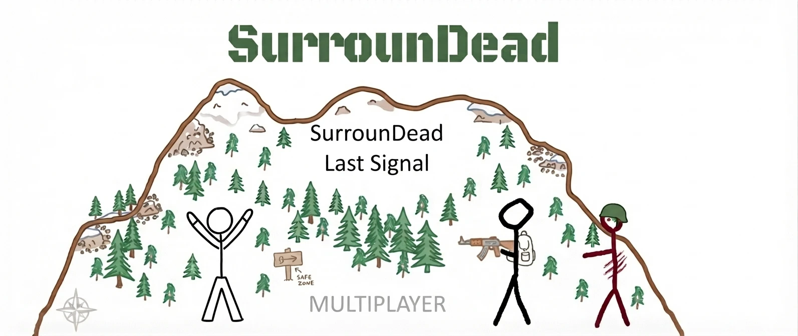

Join us on Discord for all bug reports and to see other Mods:
https://discord.gg/aDhks82XTv

# Last Signal

**Dedicated multiplayer servers for SurrounDead** – an unofficial fan modification by Fabinext.

> [!IMPORTANT]
> - **Only for SurrounDead 0.7** (the current stable Steam version). The 0.8 experimental/beta branch does not work.
> - **All other mods must be uninstalled.** Last Signal does not work together with other UE4SS or pak mods.
> - **Do a clean install first:** back up your saves, delete everything and reinstall the game once from Steam.
>   See [Clean install](#clean-install-do-this-first) below.

Last Signal lets you join community servers in SurrounDead and play together with other players in a shared
world: zombies, loot, vehicles, chat and admin tools. This repository contains the **client** (the part every
player installs). The server software is not public yet.

> Unofficial fan project. Not affiliated with, endorsed by or connected to the developers or the publisher of
> SurrounDead. Use at your own risk.

---

## Features

- **Server browser** in the journal: press **J** → tab **SERVER**. Shows all running servers with player count
  and ping. Click a server to select it, then **JOIN**.
- **Password-protected servers** (`[LOCKED]`) and **join by address** for private servers.
- **Chat** (default key **Enter**, changeable in the SERVER tab).
- **Shared world**: zombies, animals, loot and items on the ground are synchronised with the server.
- **Vehicles**: driving, refuelling and repairing; a second player can sit in the passenger seat.
- **Your own character**: you join with the character from your own save. Your single-player save stays
  untouched; when you leave the server (or the connection drops), your own save is loaded again.
- **Admin tools** for server admins: player list (go to, bring, kick, ban), time and weather, the game's debug
  menu.

## Requirements

- Windows 10/11
- SurrounDead **0.7** on Steam (Steam → SurrounDead → Properties → Betas → *None*)
- No other mods installed

## Clean install (do this first)

1. **Back up your saves:** copy the folder `%LOCALAPPDATA%\SurrounDead\Saved\SaveGames` to a safe place
   (e.g. your desktop). Paste the path into the Windows Explorer address bar to open it.
2. **Note where the game is installed:** Steam → right click SurrounDead → Manage → *Browse local files*.
3. **Uninstall SurrounDead** in Steam (right click → Manage → Uninstall).
4. **Delete everything that is left:** the game folder from step 2 (if it still exists) and the folder
   `%LOCALAPPDATA%\SurrounDead`.
5. **Reinstall SurrounDead from Steam** (version 0.7, Betas → *None*), start it once until the main menu and
   close it.
6. **Copy your saves back** into `%LOCALAPPDATA%\SurrounDead\Saved\SaveGames`.
7. Now install Last Signal (below).

## Installation

1. Download **`LastSignal-Installer.exe`** from the [Releases](../../releases) page.
2. Close the game and run the installer. It finds the game folder automatically (or use *Browse...*).
3. Leave **"Remove all other mods"** checked (recommended). Other mods are not deleted, they are moved to
   `LastSignal_ModBackup` inside the game folder.
4. Click **INSTALL**.

Windows may show a SmartScreen warning because the installer is not signed: *More info* → *Run anyway*.

The installer adds [UE4SS](https://github.com/UE4SS-RE/RE-UE4SS) (the mod loader) and Last Signal to the game
folder. It does not change any game files.

## Joining a server

1. Start the game and **load your own save** (joining from the main menu is not possible).
2. Press **J** and open the **SERVER** tab.
3. Click a server, then **JOIN**. For `[LOCKED]` servers you are asked for the password.
4. Private servers: **JOIN BY ADDRESS** and enter `address:port`.

**Leave** a server with **LEAVE SERVER** in the same tab.

**Admin rights:** the SERVER tab shows **YOUR PLAYER ID** (click to reveal). Give it to the server owner if you
should become an admin. Keep it private – it works like a password.

## Uninstall

Run the installer and click **Uninstall**, or delete `dwmapi.dll` and the folder `ue4ss` in
`SurrounDead\Binaries\Win64`.

## Troubleshooting

| Problem | Solution |
|---|---|
| Crash right after "Press any key" with *"BulkData compressed header read error"* | A damaged save file. Close the game, rename `%LOCALAPPDATA%\SurrounDead\Saved\SaveGames` to `SaveGames_old` and start again. Then copy your saves back one by one to find the broken one. |
| Server list says *"Master list unreachable"* | Check your internet connection / firewall, then click *refresh*. |
| Ping shows `-` | The server's host blocks ping (ICMP). Joining still works. |
| Can't join a server in your own home network | Your router needs NAT reflection (hairpin NAT). |
| Anything else | Send `SurrounDead\Binaries\Win64\ue4ss\UE4SS.log` with a short description (open an issue). |

See [KNOWN_ISSUES.md](KNOWN_ISSUES.md) for the current list of known bugs.

## Source code

| Folder | Content |
|---|---|
| `mod/` | The Lua mod (UE4SS) |
| `core/` | Native helper DLL (server list download, ping, player fix) |
| `installer/` | The installer (C#, .NET Framework 4) |

See [BUILDING.md](BUILDING.md).

## License

**All rights reserved.** The source code is published for transparency only. You may download and use the
official release to play. Copying, modifying, re-uploading or redistributing this software – in whole or in part
– requires prior written permission. See [LICENSE](LICENSE).

Third-party components (UE4SS) are under their own licenses, see
[THIRD_PARTY_NOTICES.md](THIRD_PARTY_NOTICES.md).

SurrounDead is a trademark of its respective owner. All game content belongs to its respective owners.
